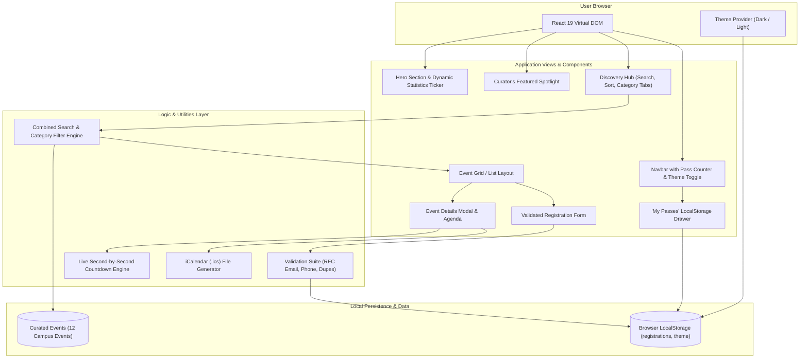

# K Explore — Campus Event Discovery & Management Platform

[](https://github.com/zafarjamal99/k-explore/actions)
[](LICENSE)
[](https://vitejs.dev/)
[-green.svg)](https://vitest.dev/)

**K Explore** is a premium, modern, fully responsive event management and discovery platform engineered specifically for university communities, academic societies, collegiate clubs, and student leaders. It replaces scattered chat announcements and outdated bulletin boards with an elegant, centralized web application where attendees can explore upcoming events, filter across seven categories, inspect verified agendas, reserve passes, and manage tickets locally.

---

## 1. Problem Statement & Objectives

### The Problem
University students and campus organizers consistently experience fragmented event discovery:
- Event notices are scattered across messaging groups, social media, and physical posters.
- Schedule changes, venue shifts, and deadlines are frequently missed.
- Registration forms are often clunky third-party spreadsheets lacking real-time validation, duplicate detection, and instant confirmation passes.

### Objectives
1. **Centralize Campus Discovery**: Present a unified, curated directory of collegiate events across Technical, Cultural, Workshop, Sports, Entrepreneurship, Competition, and Seminar categories.
2. **Real-time Schedule Integrity**: Provide precise schedules, campus building/room locations, speaker dossiers, and live countdown timers.
3. **Frictionless Local RSVP**: Deliver instantaneous registration validation with duplicate-entry prevention and persistent digital QR passes stored in browser `LocalStorage`.
4. **Editorial UI/UX Standards**: Adhere to an Apple-inspired minimalist aesthetic using warm luxury neutrals (#F7F6F2 / #101820) and terracotta accents (#C97958), avoiding neon glows or cluttered AI gradients.

---

## 2. Key Features

- **Editorial Homepage & Curator's Spotlight**: Bold typographic hierarchy, live campus statistics ticker, and curated featured event showcase with full countdown clock.
- **Dynamic Search & Multi-Category Filtering**: Real-time debounce search across titles, descriptions, venues, speakers, and tags, alongside interactive category tabs with live count indicators.
- **Sort & Layout Controls**: Sort by date (earliest/latest), alphabetical title, or attendee popularity, with one-click toggling between responsive Grid and List layouts.
- **Deep-Dive Event Modals**: High-resolution banners, program agendas, speaker profiles, venue maps, and standard `.ics` calendar invitation file export.
- **Validated Registration System**: Client-side RFC 5322 email checking, 10-digit phone verification, duplicate RSVP detection, and animated confetti celebration.
- **Digital Pass & QR Code Generator**: Generates an official printable attendee ticket with unique reference ID (`KX-2026-XXXXX`), QR scan badge, and event metadata.
- **"My Passes" Storage Drawer**: View, inspect, backup as JSON, or cancel registrations persisted in browser `LocalStorage`.
- **Accessible Dark & Light Modes**: Seamless theme toggle preserving user preferences with semantic CSS variables and WCAG 2.2 AA contrast compliance.

---

## 3. Technology Stack

| Layer | Technology | Rationale |
|---|---|---|
| **Structure & Logic** | HTML5, Modern ECMAScript (ES2024), React 19 | Semantic structure, declarative UI state, and reactive updates |
| **Styling & Design System** | Pure CSS3, CSS Custom Properties (Variables) | Zero-overhead, predictable performance, strict adherence to design tokens |
| **Icons & Micro-interactions** | `lucide-react`, `canvas-confetti` | Consistent iconography and delightful confirmation feedback |
| **Tooling & Bundler** | Vite 8 | Lightning-fast HMR and optimized production treeshaking |
| **Test Runner & Environment** | Vitest 5, `@testing-library/react`, `jsdom` | Fast unit and integration tests with DOM emulation |
| **Persistence** | Browser `LocalStorage` API | Offline-ready, client-side demo registration persistence |
| **CI / Automation** | GitHub Actions | Automated multi-version Node testing and build verification |

---

## 4. System Architecture



---

## 5. Design System Tokens

The application strictly implements the design specifications:

| Token | Light Theme | Dark Theme | Role |
|---|---|---|---|
| `--bg-primary` | `#F7F6F2` | `#101820` | Base canvas (warm paper / deep obsidian) |
| `--bg-secondary` | `#FFFFFF` | `#19232D` | Elevated surfaces, cards, modals |
| `--primary-text` | `#191B1F` | `#F5F3EE` | High-contrast editorial headlines |
| `--secondary-text` | `#686B70` | `#AAB3BC` | Body typography and metadata |
| `--primary-brand` | `#243B53` | `#9BB5CE` | Deep slate navy / soft steel |
| `--accent` | `#C97958` | `#D58C6B` | Terracotta warm rust accent |
| `--border` | `#E6E3DC` | `#303B46` | Subtle dividers and outlines |
| `--muted-surface` | `#EFEEE9` | `#212C37` | Filter pill backgrounds & search inputs |

---

## 6. Directory Structure

```
k-explore/
├── .github/
│   └── workflows/
│       └── ci.yml               # GitHub Actions CI workflow
├── public/
│   └── favicon.svg              # K Explore compass monogram
├── src/
│   ├── assets/                  # Static media assets
│   ├── components/
│   │   ├── AboutSection.jsx     # Platform intro and final CTA
│   │   ├── CategoryFilter.jsx   # Horizontal category selector with counters
│   │   ├── CountdownTimer.jsx   # Live second-by-second countdown clock
│   │   ├── EmptyState.jsx       # Zero-match state with filter reset action
│   │   ├── EventCard.jsx        # Editorial event card with quick actions
│   │   ├── EventDetailsModal.jsx# Deep event sheet with agenda & .ics export
│   │   ├── FeaturedEvent.jsx    # Wide spotlight showcase component
│   │   ├── Footer.jsx           # Editorial footer with navigation & disclaimer
│   │   ├── Hero.jsx             # Hero headline, copy, and CTAs
│   │   ├── LoadingSkeleton.jsx  # Pulse loading skeleton cards
│   │   ├── MyRegistrationsModal.jsx # Saved ticket pass manager
│   │   ├── Navbar.jsx           # Responsive header with mobile drawer
│   │   ├── SearchBar.jsx        # Debounced search input with clear trigger
│   │   ├── StatsBanner.jsx      # Campus scale & feature statistics
│   │   ├── ThemeToggle.jsx      # Dark / light theme toggle
│   │   └── Toast.jsx            # Toast notification component
│   ├── data/
│   │   └── events.js            # Curated 12-event collegiate dataset
│   ├── features/
│   │   └── registration/
│   │       ├── RegistrationForm.jsx     # Form with inline errors & ticket pass
│   │       ├── registrationService.js   # Async submission and saving service
│   │       └── registrationValidation.js# Validation rules & duplicate checker
│   ├── hooks/
│   │   └── useTheme.js          # Theme state & DOM synchronization hook
│   ├── styles/
│   │   ├── globals.css          # Reset, typography, utility classes, animations
│   │   ├── responsive.css       # Responsive breakpoints, grids, and print styles
│   │   └── variables.css        # Semantic CSS custom property design tokens
│   ├── utils/
│   │   ├── calendarUtils.js     # Standard .ics iCalendar file generator
│   │   ├── dateUtils.js         # Date formatting and countdown calculations
│   │   └── storageUtils.js      # LocalStorage persistence & duplicate helpers
│   ├── App.jsx                  # Main application orchestrator
│   └── main.jsx                 # React root entry point
├── tests/
│   ├── setup.js                 # Vitest test setup and localStorage cleaner
│   ├── unit/
│   │   ├── dateUtils.test.js    # Date and countdown unit tests
│   │   ├── registrationValidation.test.js # Validation rules unit tests
│   │   └── storageUtils.test.js # LocalStorage operations unit tests
│   └── integration/
│       └── EventDiscovery.test.jsx # Component discovery & filter integration tests
├── .env.example
├── .gitignore
├── index.html
├── LICENSE
├── package.json
└── vite.config.js
```

---

## 7. Installation & Local Development

### Prerequisites
- **Node.js**: v18.0.0 or higher (v20+ recommended)
- **npm**: v9.0.0 or higher
- **Git**

### Step-by-Step Setup
1. Clone repository:
   ```bash
   git clone https://github.com/zafarjamal99/k-explore.git
   cd k-explore
   ```

2. Install dependencies:
   ```bash
   npm install
   ```

3. Launch local development server:
   ```bash
   npm run dev
   ```
   Open `http://localhost:5173` in your browser.

4. Run the automated test suite:
   ```bash
   npm run test
   ```

5. Build optimized production bundle:
   ```bash
   npm run build
   ```

6. Preview the production build locally:
   ```bash
   npm run preview
   ```

---

## 8. Deployment Guide

### Deploying to Vercel (Recommended)
1. Push your repository to GitHub.
2. In the Vercel dashboard, click **Add New Project** and import `k-explore`.
3. Vercel automatically detects Vite:
   - **Framework Preset**: Vite
   - **Build Command**: `npm run build`
   - **Output Directory**: `dist`
4. Click **Deploy**. The platform will be live over HTTPS in under a minute.

### Deploying to Netlify
1. Connect repository in Netlify.
2. Configure build settings:
   - **Build command**: `npm run build`
   - **Publish directory**: `dist`
3. Click **Deploy Site**.

### Deploying to GitHub Pages
1. In `vite.config.js`, configure `base: '/k-explore/'`.
2. Run `npm run build`.
3. Deploy the `dist/` directory via the `gh-pages` branch or GitHub Pages workflow.

---

## 9. LocalStorage Behavior & Boundaries

- **Client Storage**: All registration records are preserved in the user's browser under key `k_explore_registrations`.
- **Scope & Privacy**: Data remains on the attendee's physical device; no server transmits or logs personal data.
- **Clearing Data**: Users can cancel RSVPs individually via "My Passes" or clear browser site data to reset.
- **Production Extension**: In a production enterprise deployment, `registrationService.js` would dispatch JSON payloads to an authenticated Node/Express or Supabase PostgreSQL endpoint with transactional integrity.

---

## 10. License

This project is open source and available under the [MIT License](LICENSE).
