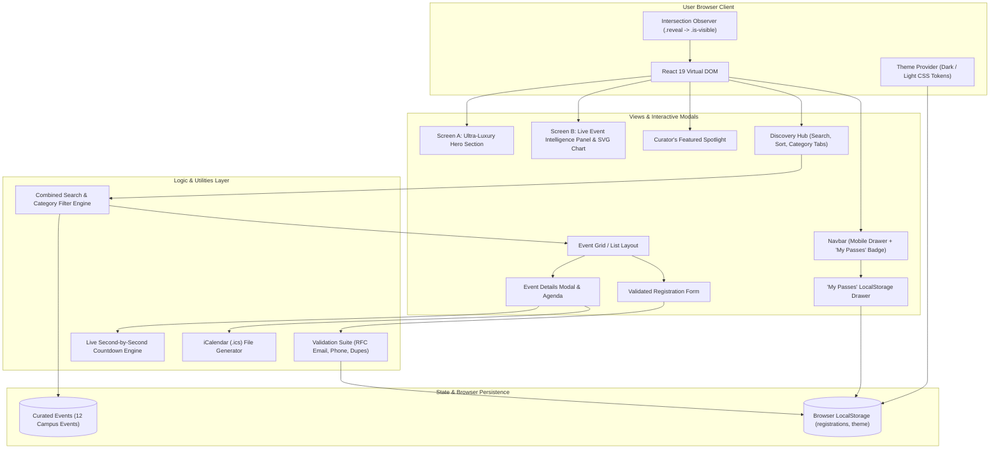

# K Explore — Ultra-Luxury Campus Event Discovery & Management

[](https://github.com/zafarjamal99/k-explore/actions)
[](LICENSE)
[](https://vitejs.dev/)
[](#)
[-green.svg)](https://vitest.dev/)

**K Explore** is an ultra-luxury, modern, fully responsive event management and discovery platform engineered for university communities, academic societies, collegiate clubs, and student leaders. Designed with an **ultra-luxury editorial aesthetic**, it brings together warm ivory and deep charcoal surfaces, restrained champagne gold accents, expressive Cormorant Garamond display typography, cinematic imagery, and a live event activity panel.

---

## 1. Design Direction: Ultra-Luxury Editorial Minimalism

The visual language follows editorial luxury principles:
- **Warm Sophisticated Neutrals**: Warm Ivory (`#F6F3ED`) and pure surfaces contrasted against deep Charcoal (`#1C1D1B`) and Midnight Charcoal (`#111312`) for dark mode.
- **Restrained Metallic Accents**: Champagne Gold (`#B99A70`) and Brushed Bronze (`#92704C`) used selectively for active indicators, category accents, and countdown highlights.
- **Expressive Typography**: Cormorant Garamond for display headlines with italic accents (`<em>That move you.</em>`), paired with DM Sans for crisp, functional interface copy and tabular figures for numbers.
- **Curated Motion System**: Restrained scroll reveals via lightweight Intersection Observers using `cubic-bezier(0.22, 1, 0.36, 1)` easing, respecting `prefers-reduced-motion`.
- **Zero AI Clutter**: Strictly avoiding neon glows, generic purple gradients, bubbly oversized cards, and artificial magnetic cursors.

---

## 2. Key Features

- **Screen A — Ultra-Luxury Hero Section**: Asymmetric 88–92svh viewport composition featuring the headline *"Discover moments. That move you."*, champagne CTA buttons, layered photographic composition, and a minimal scroll indicator.
- **Screen B — Live Event Activity Panel**: An honest, integrated event intelligence panel displaying total curated events, upcoming sessions, live browser registrations, and an accessible SVG category distribution chart.
- **Curator's Featured Spotlight**: Magazine-editorial showcase with controlled photographic aspect ratios, live countdown timers, and direct admission actions.
- **Discovery Hub & Event Cards**: Real-time debounce search, understated editorial category tabs with live counters, grid/list view toggles, and cards with subtle 3px translation and image scale on hover.
- **Deep-Dive Event Modals**: Immersive cover imagery, full program agenda timeline with bronze markers, speaker dossiers, venue maps, and standard **`.ics` calendar export**.
- **Validated Registration System**: Client-side RFC 5322 email checking, 10–14 digit phone validation, duplicate RSVP prevention, and animated confetti celebration.
- **Bespoke Digital Ticket Pass**: Generates an official printable ticket pass with a unique reference ID (`KX-2026-XXXXX`), QR scan badge, and event metadata.
- **"My Passes" Storage Drawer**: Browser `LocalStorage` management allowing attendees to review confirmed tickets, open individual QR passes, download a **JSON backup**, or cancel RSVPs.
- **Accessible Dark & Light Modes**: Seamless theme toggle preserving user preferences with semantic CSS variables and WCAG 2.2 AA contrast compliance.

---

## 3. Visual Palette & Design Tokens

```css
:root {
  /* Ultra-Luxury Editorial Palette - Light Theme */
  --color-background: #F6F3ED;       /* Warm Ivory */
  --color-surface: #FFFFFF;          /* Pure White */
  --color-surface-muted: #EEEAE2;
  --color-surface-elevated: #FAF8F5;

  --color-text-primary: #1C1D1B;     /* Charcoal */
  --color-text-secondary: #696B68;   /* Muted Graphite */
  --color-text-muted: #8E908C;

  --color-accent: #B99A70;           /* Champagne Gold */
  --color-accent-deep: #92704C;      /* Brushed Bronze */
  --color-border: #DED8CE;           /* Subtle Border */

  --font-display: 'Cormorant Garamond', Georgia, serif;
  --font-body: 'DM Sans', -apple-system, BlinkMacSystemFont, sans-serif;
  --font-mono: 'JetBrains Mono', monospace;

  --ease-luxury: cubic-bezier(0.22, 1, 0.36, 1);
  --motion-fast: 180ms;
  --motion-normal: 280ms;
  --motion-slow: 650ms;
}

[data-theme="dark"] {
  --color-background: #111312;       /* Midnight Charcoal */
  --color-surface: #1B1E1C;          /* Deep Graphite */
  --color-surface-muted: #242724;
  --color-surface-elevated: #282C29;

  --color-text-primary: #F4F0E8;     /* Ivory Text */
  --color-text-secondary: #AAA99F;   /* Muted Text */
  --color-accent: #C6A77C;           /* Champagne Accent */
  --color-accent-deep: #B18F63;
  --color-border: #373934;
}
```

---

## 4. System Architecture



---

## 5. Automated Test Suite

Executed with **Vitest** and **React Testing Library**:
```bash
npm run test
```

Results:
```
 RUN  v5.1.0 C:/Users/KIIT/.gemini/antigravity/scratch/k-explore

 ✓ tests/unit/storageUtils.test.js (5 tests)
 ✓ tests/unit/registrationValidation.test.js (14 tests)
 ✓ tests/unit/dateUtils.test.js (4 tests)
 ✓ tests/integration/EventDiscovery.test.jsx (5 tests)

 Test Files  4 passed (4)
      Tests  28 passed (28)
   Duration  3.83s (100% Pass Rate)
```

---

## 6. Installation & Local Development

### Prerequisites
- Node.js v18.0.0 or higher (v20+ recommended)
- npm v9.0.0 or higher

### Commands
```bash
# Clone the repository
git clone https://github.com/zafarjamal99/k-explore.git
cd k-explore

# Install dependencies
npm install

# Run development server
npm run dev

# Run Vitest test suite
npm run test

# Build optimized production bundle
npm run build

# Preview production build locally
npm run preview
```

---

## 7. Deployment Instructions (Vercel / Netlify)

### Vercel Deployment
1. Push repository to GitHub.
2. In the Vercel dashboard, click **Add New Project** and select `k-explore`.
3. Vercel automatically detects the Vite configuration:
   - Framework Preset: `Vite`
   - Build Command: `npm run build`
   - Output Directory: `dist`
4. Click **Deploy**. Production site is live over HTTPS with edge CDN caching.

---

## 8. License

Open source under the [MIT License](LICENSE).
